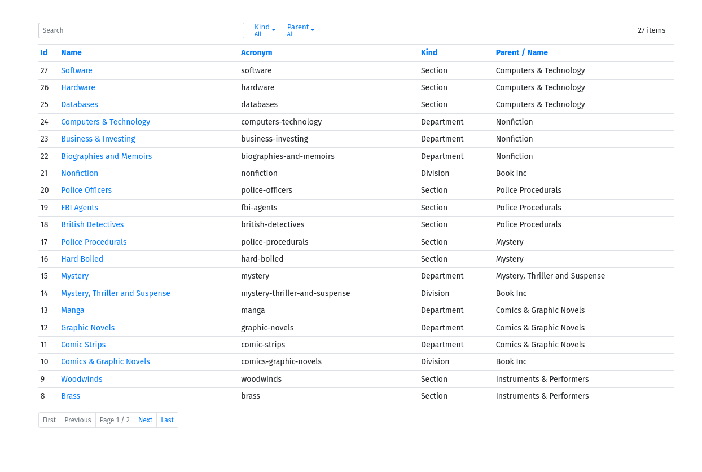
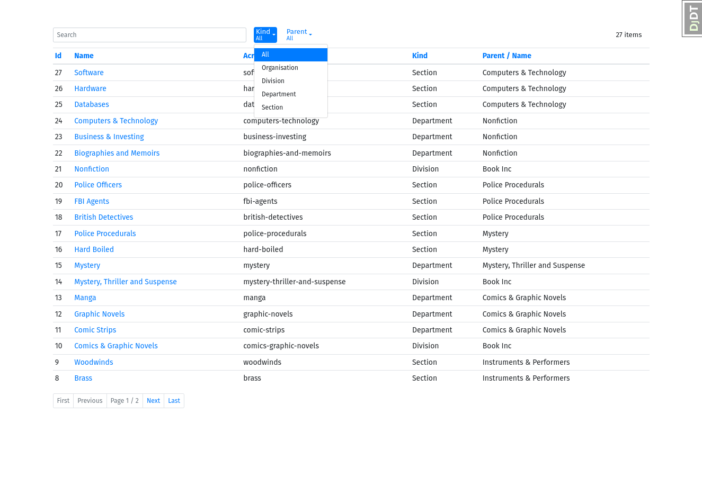
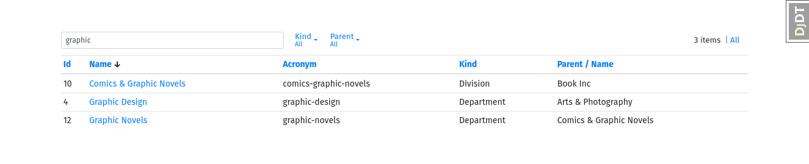

# ItemList

ItemList is a customizable Django Admin ChangeList-like app for use outside of the admin. It can be used to create versatile paginated lists of objects which can be searched, filtered and provide links to detail pages similarly to the admin ChangeLists.

Provides a generic class-based view `ItemListView`.

## ItemListView

**class `itemlist.views.ItemListView`**

A page representing a list of objects, with a search box, list filters, sortable columns, pagination and optional links to detailed pages.

**Ancestors (MRO)**  
This view inherits methods and attributes from the following Django views:

- `django.views.generic.list.ListView`
- `django.views.generic.list.MultipleObjectTemplateResponseMixin`
- `django.views.generic.base.TemplateResponseMixin`
- `django.views.generic.list.BaseListView`
- `django.views.generic.list.MultipleObjectMixin`
- `django.views.generic.base.View`

### Methods and attributes

**`list_columns`**  
: A list of field names to display in columns. Supports double underscore lookups. Non-field model attributes and methods can be used by specifying the attribute or method name as a string. In this case the value of the attribute or the result of the method will be displayed in the column. However, sorting and filtering will not work for these columns by default. To enable sorting through an associated field, set the `sort_field` attribute on the method. The title of the column can be customized by adding a `short_description` attribute to the method.

**`list_filters`**  
: A list of field names or `django.contrib.admin.SimpleListFilter` instances for generating filters on the list.

**`list_search`**  
: A list of field names to include in search operations. Supports double underscore lookups.

**`list_transforms`**  
: A dictionary mapping field names to functions for transforming column values before display. Transform functions must take two arguments `transform(value, obj)`, where `obj` is the object corresponding to the list row.

**`list_headers`**  
: A dictionary mapping field names to header names for explicitly specifying the column header text.

**`list_styles`**  
: A dictionary mapping field names to css style classes to add to the HTML of the columns.

**`list_title`**  
: A string to use as the title of the list. If `None` (default), the model name is used.

**`link_url`**  
: A named url for creating links to detailed pages. If `None` (default), no links are created.

**`link_kwarg`**  
: The link kwarg parameter for `link_url`. Default is `pk`

**`link_attr`**  
: By default links are created with the url in the `href` attribute of an anchor tag. The attribute can be changed by setting the `link_attr` parameter of the view. For example setting `link_attr` to `data-link` will create a tag that looks like `<a href="#!" data-link="http://...">...</a>`. This is useful for loading content using JavaScript into modals or for ajax. This parameter replaces the previous `link_data` boolean.

**`link_field`**  
: Column name on which to create links. Must be one of the names included in `list_columns`. By default the first column will be used.

**`add_facets`**  
: Boolean to show or hide the facet counts within the filter titles. Default is `False`.

**`get_list_columns()`**  
: Return the field names to display in columns. By default, returns the value of `list_columns`.

**`get_list_filters()`**  
: Return the `list_filters` to display. By default, returns the value of `list_filters`.

**`get_list_search()`**  
: Return the list of field names to include in search operations. By default, returns the value of `list_search`.

**`get_list_transforms()`**  
: Return the dictionary of transforms to use for the columns. By default, returns the value of `list_transforms`.

**`get_list_headers()`**  
: Return the dictionary of column headings. By default, returns the value of `list_headers`.

**`get_list_styles()`**  
: Return the dictionary of column css styles. By default, returns the value of `list_styles`.

**`get_list_title()`**  
: Return the title of the list. By default, returns the value of `list_title`.

**`get_link_url(obj)`**  
: Return the detail url link for the current object/row. By default, uses the named url from `link_url`, the `kwarg` from `link_kwarg` and the value of the attribute.

**`get_link_kwarg()`**  
: Return the `kwarg` to use for the detail `link_url`. By default, returns the value of `link_kwarg`.

**`get_link_field()`**  
: Return the name of the column on which to create the detail links. By default, returns the first column.

**`get_link_attr()`**  
: Return the `attr` to use for the detail `link_url`. By default, returns the value of `link_attr`.


### Advanced filters from `itemlist.filters`

The `itemlist.filters` module provides ready-made list-filter factories for date-based filtering. They are especially useful when you want `ItemListView.list_filters` to offer preset ranges instead of only exact field matches.

These helpers return filter classes, so use them in `list_filters` like any other `SimpleListFilter`:

```python
from itemlist.filters import YearFilter, StartYearFilter, EndYearFilter, MonthFilter, QuarterFilter
from itemlist.views import ItemListView

class InvoiceList(ItemListView):
    model = Invoice
    list_filters = [
        YearFilter('issued_at'),
        StartYearFilter('issued_at'),
        EndYearFilter('issued_at'),
        QuarterFilter('issued_at'),
        MonthFilter('issued_at'),
    ]
```

Available helpers:

- `YearFilter(field_name='created', reverse=True)` groups records by year and filters to a selected year.
- `StartYearFilter(field_name='created')` filters records whose year is greater than or equal to the selected year.
- `EndYearFilter(field_name='created')` filters records whose year is less than or equal to the selected year.
- `QuarterFilter(field_name='created')` filters by calendar quarter (`Q1`-`Q4`).
- `MonthFilter(field_name='created')` filters by calendar month.
- `ExpiryDateFilter(field_name='due_date')` filters by common due-date ranges such as expired, today, tomorrow, within 7 days, this month, and this year.

Examples:

```python
class OrderList(ItemListView):
    model = Order
    list_filters = [
        YearFilter('placed_at'),
        QuarterFilter('placed_at'),
    ]
```

```python
class ReportList(ItemListView):
    model = Report
    list_filters = [
        StartYearFilter('published_at'),
        EndYearFilter('published_at'),
    ]
```

```python
from itemlist.filters import ExpiryDateFilter

class TaskList(ItemListView):
    model = Task
    list_filters = [ExpiryDateFilter('due_date')]
```

Use these filters when you need quick time-range navigation in the list view without writing custom filter classes for each model.


## Example `views.py`

```python
from django.utils import timezone
from itemlist.views import ItemListView

from library.models import Topic

class TopicList(ItemListView):
    template_name = 'myapp/topic_list.html'
    model = Topic
    list_filters = ['kind', 'parent']
    list_columns = ['id', 'name', 'acronym', 'kind', 'parent__name']
    list_search = ['name', 'kind__name']
    list_headers = {'parent__name': 'Mommy'}

    link_url = 'library:topic-detail'
    link_field = 'name'
    paginate_by = 20

    def get_context_data(self, **kwargs):
        context = super().get_context_data(**kwargs)
        context['now'] = timezone.now()
        return context
```

## Example `urls.py`

```python
from django.urls import path

from library.views import TopicList

app_label = 'library'
urlpatterns = [
    path('', TopicList.as_view(), name='topic-list'),
]
```

## Template examples

Examples for `myapp/topic_list.html`. The default template if none is specified is exactly the same as below:

```django


    

```

Another template example, equivalent to above. This allows you to reorder/omit components:

```django



```

## Screenshots

  
  

